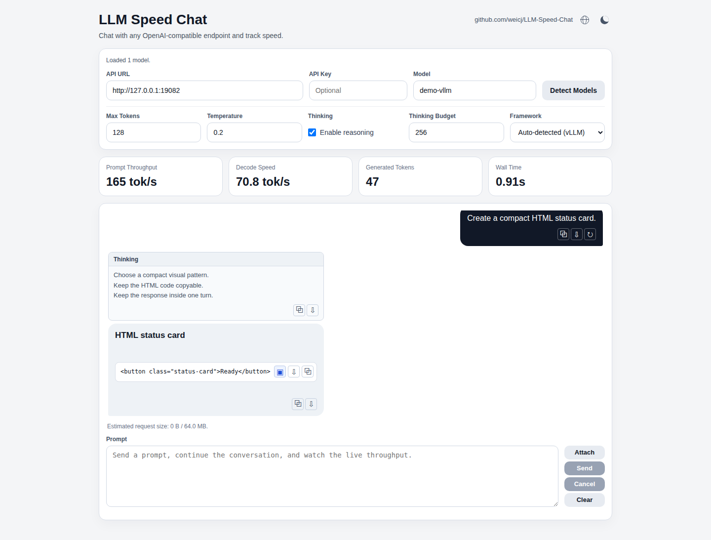

<p align="center">
  
  
  
  
  
  
  
</p>

<h1 align="center">LLM Speed Chat</h1>

<p align="center">
  用于测量 OpenAI 兼容推理服务交互式性能的单用户聊天测速工具。
</p>

<p align="center">
  工具来源：<a href="https://github.com/weicj/LLM-Speed-Chat">github.com/weicj/LLM-Speed-Chat</a>
</p>

<p align="center">
  
</p>

这是一个真实的多轮对话测试框架，而非单次基准测试：流式接收回复、独立查看思考过程、
渲染 Markdown 和 HTML，并追踪 prompt 吞吐、解码速度、生成 token 数和实际耗时。

## 快速开始

从源码运行：

```bash
python3 -m pip install -e .
llm-speed-chat --upstream-base-url http://127.0.0.1:8000 --model your-model-id
```

或直接从仓库根目录运行：

```bash
python3 server.py
```

打开 `http://127.0.0.1:9000`。相同的命令适用于本地或托管的 OpenAI 兼容端点。

常用环境变量：

```bash
UPSTREAM_BASE_URL=http://127.0.0.1:8000
UPSTREAM_API_KEY=
MODEL=
HOST=127.0.0.1
PORT=9000
```

## 功能

- 自动从 `/v1/models` 发现模型，支持手动 `Detect Models` 回退
- 多轮流式聊天，支持取消、清空、重试、附件和 Enter 发送
- 独立五行动态滚动 Thinking 面板和 GitHub 风格 Markdown 输出
- 消息复制/保存操作、HTML/SVG 代码下载、沙箱 HTML 预览
- 中英文切换和持久化亮/暗模式
- 端点无关的指标，当端点提供时使用框架感知的精确值

## 指标与框架

Framework 选择器从模型元数据自动检测，可手动覆盖为 `llama.cpp`、vLLM、SGLang、
ExLlama 或 Universal。

- 本地 llama.cpp 和 vLLM 端点请求 token ID；llama.cpp 的 timing 字段用于其最终解码速率。
- SGLang 请求连续用量统计；ExLlama 使用其标准 OpenAI 兼容 usage 响应。
- Universal 是托管或未识别 API 的回退方案。缺失的精确计数以 `~` 标记为临时值，
  直到标准 usage 返回。
- Wall Time 在浏览器中从请求开始到流完成、取消或失败时测量。

## Docker

```bash
docker build -t llm-speed-chat .
docker run --rm -p 9000:9000 \
  --add-host host.docker.internal:host-gateway \
  -e UPSTREAM_BASE_URL=http://host.docker.internal:8000 \
  llm-speed-chat
```

也支持 Compose：

```bash
docker compose up --build
```

## 开发

运行测试套件：

```bash
python3 -m unittest discover -s tests -v
npm ci
npm run test:e2e
```

浏览器测试使用 Playwright 和 Chromium。

构建和发布检查：

```bash
python3 -m build
./scripts/check-release.sh
python3 scripts/audit-release-metadata.py --strict
```

发布说明和发布清单见 `CHANGELOG.md` 和 `RELEASE.md`。CI 覆盖可编辑安装、
构建的 wheel 和容器镜像。
